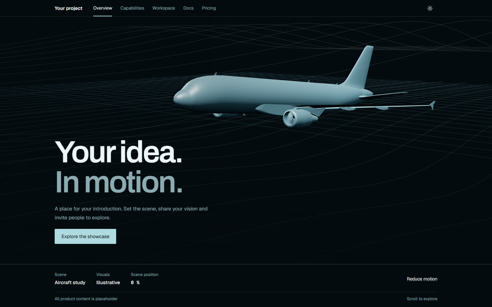

# Flight showcase template

A standalone aircraft landing-page template with a dark blue-black palette, ice-blue accents, A320 geometry and a scroll-driven camera. Product copy, capabilities, workspace, documentation, pricing, contact and legal content are placeholders.



## Run

Requires Node.js 20.9 or later.

```sh
npm ci
npm run dev
```

Open http://localhost:3000.

## Check and build

```sh
npm run check:public
npm run typecheck
npm run lint
npm run build
```

Use `npm start` to preview the built static site locally.

The static website is generated in `out/`. It requires no database, account, API keys, billing service or backend. The aircraft motion and linework are illustrative.

## Personalise

- Name and navigation: `lib/site.ts`.
- Home-page text: `components/home-film.tsx`.
- Palette and layouts: `app/globals.css`.
- Placeholder routes: the folders in `app/`.
- Camera: `lib/camera-path.ts`.
- Aircraft: `public/models/aircraft.glb`.

Mobile, reduced-motion, WebGL failure and JavaScript-free views use static aircraft posters. The motion preference and theme are saved locally in the visitor's browser.

## Publish as a separate GitHub repository

This folder has no inherited Git history or remote. Open a terminal **inside this folder**, then initialise a new repository:

```sh
git init -b main
git add .
git commit -m "Initial aircraft showcase template"
```

Create a new GitHub repository and follow its instructions for adding the new remote and pushing this folder. Choose your code licence before publishing. Review `ASSET_NOTICES.md`: the aircraft asset's redistribution permission remains unconfirmed.

Do not initialise or publish from a parent folder. Only this template folder belongs in the new public repository. Build output, local settings and dependencies are ignored.

For GitHub Pages under a repository subpath, build with `NEXT_PUBLIC_BASE_PATH=/your-repository` and publish `out/` through GitHub Actions; include an empty `.nojekyll` file in the deployed output. For a domain-root static host, leave the base path unset.

## Browser checks

```sh
npx playwright install chromium
npm run test:e2e
```

The checks cover desktop scrolling, mobile layout, reduced motion, placeholder navigation, theme controls and the absent interactive tool routes.

## Regenerate aircraft posters

Run the dev server, then run `npm run assets:posters` in another terminal. Set `PREVIEW_URL` if the server is on another port, or `PLAYWRIGHT_CHANNEL=msedge` to use an installed Edge browser. This renders only the aircraft canvas; page text is excluded. Rebuild afterwards so the export includes the updated posters.
